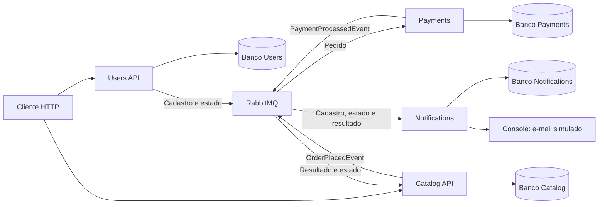
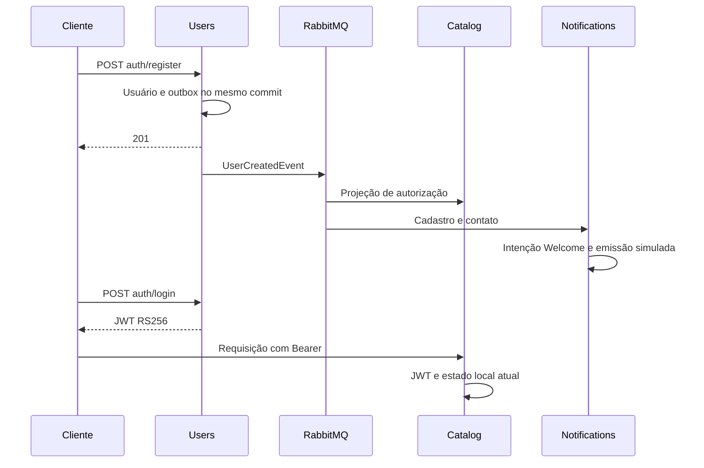
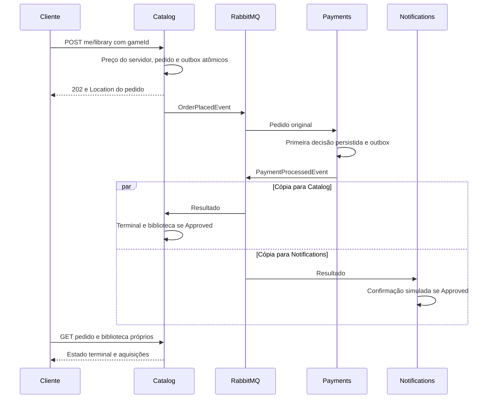

# Arquitetura e eventos

Cada serviço tem repositório, solução, imagem e banco próprios. A instância local
PostgreSQL hospeda quatro bancos com roles isoladas; não há consulta entre bancos
pelos serviços. O cliente chama Users e Catalog por HTTP. A comunicação de negócio
entre serviços passa por RabbitMQ/MassTransit, usando filas duráveis independentes.

## Cadastro e autorização

Users persiste usuário e intenção de publicação no mesmo commit. A outbox publica
`UserCreatedEvent`; Notifications registra uma intenção Welcome e o dispatcher a
emite no console. Catalog recebe somente a projeção mínima de autorização. Cada
consumidor tem sua cópia do evento: as filas não disputam a mesma mensagem.

JWT dura 15min, com tolerância zero; apenas Users possui a chave privada.
Bloqueio/exclusão/rebaixamento chegam por eventos. Até a entrega, o consumidor pode
observar o estado anterior; estado ausente retorna 503 com Retry-After1. Snapshot
recupera estado sem inventar cadastro: um Created atrasado ainda pode gerar o único
Welcome. Veja [identidade](identity-contracts.md) e [ordenação](identity-ordering.md).

## Compra e resultado

O preço é snapshot do aceite: 59,90 com 25% resulta 44,93. Edição, desativação ou fim
da promoção posterior não alteram o pedido. A simulação padrão espera 2s e aprova
preços até 500 inclusive; acima disso retorna Rejected/AmountAboveLimit. Rejected
não adiciona biblioteca nem confirmação. A primeira decisão durável é preservada
mesmo com reentrega, concorrência ou mudança posterior da política.

## Falhas e implantação

Outbox, deduplicação de negócio, diagnóstico de conflitos e replay local preservam
os efeitos. Não há transação distribuída entre os bancos. Console e confirmação no
banco também não compartilham transação: crash nessa janela pode repetir uma linha
simulada. Os [procedimentos de recuperação](recovery.md) distinguem redrive de
transporte, replay de conflito e retomada de intenção.

Compose espera bootstrap de topologia antes dos hosts. No Kind, Deployments e
Services próprios usam ConfigMaps para valores públicos, Secrets para credenciais
e chaves e PVCs para PostgreSQL/RabbitMQ. Os hosts alcançam `postgres`/`rabbitmq`
por DNS de Service; a jornada verifica também os Services das quatro aplicações.
O [guia Kubernetes](../k8s/README.md) explica renderização privada, fases de apply,
readiness, acesso supervisionado e remoção exclusiva dos recursos da execução.
